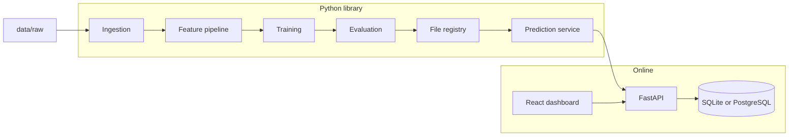

# RoadRisk architecture

Status: the data catalog, a collision quality audit, a versioned feature table, four baseline pipelines, a frozen Phase 6 evaluation, research bands, a FastAPI prediction service, SQLite prediction history, and a dashboard that calls the API exist. The 2025 test year was scored once after the model and threshold were frozen. The API does not score it again.

This document is the contract for later phases. If implementation and this document disagree, update both in the same change.

## System goal

RoadRisk estimates the severity of a reported personal-injury collision, and explains that estimate well enough for a reviewer to trace it to data, a model version, and a threshold policy.

The prediction target is collision severity given a reported collision. The reasoning and the file digests are in [data strategy](data-strategy.md). The product wording is the probability that a reported personal-injury collision is fatal or serious, given the recorded circumstances.

## Repository shape

```text
RoadRisk/
  apps/api/               FastAPI process. Phase 8, history in Phase 9.
  apps/web/               React dashboard. Moved from the Phase 2 shell.
  configs/                Data manifest. Training configs come later.
  data/                   Local data and artifacts. Contents are not committed.
  reports/                Generated audit output. Gitignored. Not a feature store.
  docs/
  src/roadrisk/           Installable library. No web framework imports.
  tests/
    unit/
    integration/          Added when a service boundary exists.
```

The dashboard is `apps/web`. It talks to `apps/api` over HTTP. It does not import the Python package.

## Layers and import rules

| Layer | Responsibility | Depends on | Must not depend on |
| --- | --- | --- | --- |
| Data | Download, checksum, schema checks, quality audit, immutable raw storage | Config | Models, API, UI |
| Features | Approved-column transforms now. Scikit-learn fitting is a later training step | Data contracts | Fitting on a test split, API, UI |
| Training | Baselines, cross-validation, tuning, artifact export | Features, config | API, UI, database |
| Evaluation | Metrics, calibration, comparison reports | Trained artifacts, held-out data | Changing the fitted pipeline |
| Model registry | Versioned pipeline, feature list, metrics, target definition, threshold policy | Files under `data/models/` | A network service |
| Prediction service | Load one artifact, validate input, return probability and risk level | Registry, feature pipeline | Route handlers, database writes |
| API | HTTP, request models, status codes | Prediction service | Training code, pandas exploration |
| Persistence | Prediction history and model metadata queries | API service layer | Feature fitting |
| Dashboard | Forms, history, model card, map | HTTP API | Model objects, database credentials |
| Configuration | Paths, logging level, database URL, seeds | Environment | Hard-coded machine paths or secrets |
| Logging | Structured operational logs | Standard library | Print-based control flow |

Rules that keep the layers separable:

- Business decisions live in library or service functions. Route functions validate HTTP and call a service.
- The dashboard calls the API. It does not import `roadrisk`, score rows locally, or open the database.
- Training jobs do not import FastAPI.
- The prediction service does not open a database connection. The API stores history after a successful prediction.
- Configuration is read at the process boundary and passed in. Modules do not read environment variables ad hoc, and they do not keep mutable global settings.

## Runtime processes



Training is a batch command, `python -m roadrisk.training`, added in Phase 5. Serving is a separate process. They share the library and the artifact format, not a running notebook.

## Machine learning design

### Leakage controls

- The implemented feature table is specified in [features](features.md). It uses a fixed code list and does not fit an imputer or encoder. Scikit-learn fitting starts in Phase 5, on the training years only.
- The time-ordered holdout is cut before imputation, encoding, scaling, feature selection, or target encoding.
- Cross-validation runs only inside the training period. Each fold refits the whole pipeline.
- Transforms that need data statistics are scikit-learn transformers inside a `Pipeline` or `ColumnTransformer`. Fit uses the training fold. The test split is transformed with that fitted state.
- Fields created by the crash itself stay out of the feature set when the target is crash severity. Examples to reject during schema review: casualty count, vehicle count, and severity.
- Historical crash features use events strictly earlier than the row time.
- A random row split is not the default. The default is a time split. Location-grouped validation is added when nearby rows would otherwise appear on both sides of a split.
- The final test period is scored once, after model and threshold choices are frozen on the validation period.

### Preprocessing

- Missingness is handled inside the pipeline. A missing indicator is kept when absence itself may carry information, such as weather left unrecorded.
- Rows are not dropped because a field is missing, unless the data-quality report shows the field is required and the missing share is negligible.
- Outliers are measured and documented. Crashes are not deleted because a numeric field is extreme. Any cap is a train-fitted transformer with a written rule.
- Categorical encoding matches the estimator. Linear models use one-hot encoding with unknown categories ignored. Tree models may use the native categorical support in `HistGradientBoostingClassifier`.
- High-cardinality location identifiers are not one-hot encoded as raw IDs. Prefer fields already in the source, such as an administrative area, or a coarser grid. Target encoding, if used, is computed inside each training fold.
- Scaling is applied for linear models only, inside that model’s pipeline. Tree pipelines skip scaling.
- Class imbalance is handled with class weights or a decision threshold, plus metrics that account for the rare class. Synthetic minority oversampling is not the default. It is allowed only inside the training fold, and only after a recorded comparison against class weights.

### Models to compare

No algorithm is selected yet. Phase 5 fits these baselines on the same folds and the same feature pipeline family:

| Model | Role |
| --- | --- |
| Majority-class baseline | Shows what a constant predictor scores |
| Logistic regression | Interpretable linear baseline and a probability reference |
| Random forest | Non-linear baseline with little tuning |
| `HistGradientBoostingClassifier` | Boosted-tree baseline shipped with scikit-learn |

XGBoost or LightGBM is added only when those four have been measured and a validation gap remains that the extra dependency can plausibly close. Popularity is not a reason to add one.

Phase 6 did not search hyperparameters. The frozen model uses the Phase 5 histogram gradient boosting settings.

### Metrics

Accuracy is reported and is not the selection metric. The comparison records:

- Precision, recall, and F1 for the positive class
- ROC-AUC
- PR-AUC
- Confusion matrix at the chosen threshold
- Brier score and a calibration curve
- Cross-validation mean and spread on the training period

False negatives and false positives are both reported. Phase 6 did not invent a cost ratio. It kept 0.5 unless positive-class F1 on 2024 improved by at least 0.01. That operating point is a research choice, not a safety or operational optimum. The Phase 6 threshold remains 0.15. Phase 7 band boundaries are separate from it.

### Risk levels

`assign_category` maps a calibrated severity probability to `LOW`, `MEDIUM`, or `HIGH`. The stored 2024 quantiles are 0.196970155937929 and 0.3126165522731136. A probability below the first value is `LOW`. A probability at or above the second value is `HIGH`. The values in between, including the lower boundary, are `MEDIUM`. Fixed cuts such as 0.33 and 0.66 are not used. The policy text is [risk policy](risk-policy.md). `POST /predictions` returns that band beside the probability and the class. See [the API note](api.md).

### Explainability

A single prediction is explained by `explain_frame`. Each approved field is replaced, one at a time, with the missing value the frozen pipeline imputes. The probability change is a local sensitivity. It is not a cause, and it is not the global ranking.

The global summary is permutation importance on a 2,000-row stratified sample of the 2024 validation split, scored by average precision. That ranking is a separate artifact. It is not a reason for one row. SHAP is not installed.

Explanations cite the 19 approved features. They do not use the target or excluded columns.

### Geographic analysis

Area summaries use `urban_or_rural_area`, an approved field with codes for Urban, Rural, and Unallocated. Administrative district codes are not used: the deprecated district code is missing on nearly every audited row, and the ONS and highway codes are not emitted. `summarize_groups` reports collision counts, band shares, and the mean probability. A group below the support minimum is omitted from `supported_groups`. The list is a sort of model-output shares among recorded collisions. It is not a ranking of safe or unsafe places, and it is not an exposure-adjusted rate.

## Artifact registry

Phase 6 writes a directory per model version under `data/models/`. Suggested contents:

- `pipeline.joblib` — the fitted sklearn pipeline, including preprocessing
- `metadata.json` — the fields below

```json
{
  "model_version": "",
  "algorithm": "",
  "git_commit": "",
  "data_version": "",
  "target_definition": "",
  "positive_class": "",
  "feature_names": [],
  "training_period": "",
  "validation_period": "",
  "test_period": "",
  "metrics": {},
  "risk_thresholds": {"medium": null, "high": null},
  "threshold_policy": "",
  "random_seed": null,
  "trained_at": ""
}
```

Phase 5 artifacts are in gitignored `data/models/baselines-v1/`. The frozen Phase 6 pipeline is in gitignored `data/models/phase6-v1/`. The live band boundaries are in gitignored `data/models/phase7-v1/risk-bands.json`, not in the Phase 6 decision file. Group and global-importance files sit in the same Phase 7 directory. MLflow is out of scope until the file registry fails a real need.

## API

Phase 8 serves the frozen artifact. Routes:

| Method | Path | Purpose |
| --- | --- | --- |
| `GET` | `/health` | Process is up, and whether an artifact loaded |
| `GET` | `/model` | Version, target definition, features, threshold, and band cuts |
| `POST` | `/predictions` | Score one reported collision |
| `GET` | `/predictions` | Accepted predictions, oldest first |
| `GET` | `/area-summaries` | Saved Phase 7 urban/rural model-output summary for the loaded decision |

`POST /predictions` accepts a Pydantic model limited to the 19 approved features. The response contains `probability`, `predicted_class`, `risk_level`, `model_version`, and `threshold_policy`. The route calls `roadrisk.inference.service` and does not transform or fit data itself. Examples and startup are in [the API note](api.md).

## Persistence

Phase 9 stores each accepted prediction after scoring. The record holds the returned probability, binary class, risk band, threshold, model identity, and a UTC timestamp. It does not hold the feature payload. `src/roadrisk/inference/service.py` does not import the database layer. `apps/api` writes the row after `predict_one` succeeds, and `GET /predictions` reads it back.

The database is SQLAlchemy 2 and SQLite by default. `ROADRISK_DATABASE_URL` overrides the URL. When it is unset, the file is `data/roadrisk.sqlite3`. SQLite stores `created_at` as UTC text (`+00:00`) because it has no timezone type. The HTTP response serializes that instant with a `Z` suffix. The schema is created in one `create_all` call. A migration tool is not used. The database file stays outside Git. PostgreSQL is not required for this single-process demo.

## Dashboard

`apps/web` is a React and TypeScript application built with Vite. It is a separate process that talks to the API over HTTP. The browser origin is allowed by `ROADRISK_CORS_ORIGINS`. The client base URL is `VITE_API_BASE_URL`, defaulting to `http://127.0.0.1:8000`.

That split is the portfolio architecture: the model, the service, and the UI can change independently, and prediction logic can be reviewed without reading components. A Streamlit app would put scoring beside widgets and is not the plan.

Views, all fed by the API:

- Score one reported collision and show the returned probability, class, and risk band
- Browse prediction history
- Show the active model identity, threshold, and band cuts from `GET /model`
- Show the saved urban/rural model-output summary when it matches the loaded decision

There is no map. District, LSOA, and highway identifiers were not approved grouping fields. The area table is not a ranking of places as safe or unsafe.

## Configuration and logging

Implemented when the first command needs them (Phase 2), not as unused modules in Phase 1.

Planned environment variables:

| Variable | Purpose |
| --- | --- |
| `ROADRISK_ENV` | `development` or `production` |
| `ROADRISK_LOG_LEVEL` | Standard library log level |
| `ROADRISK_DATA_DIR` | Root of the data directories |
| `ROADRISK_DATABASE_URL` | SQLAlchemy URL |
| `ROADRISK_MODEL_VERSION` | Artifact directory name to load |

Secrets are not given defaults. Logging uses the standard library. Each module creates its own logger. Each API request gets an `X-Correlation-ID`, described in [the API note](api.md). Failure logs include that ID, the method, the path, and the status. They do not include the request body or the database URL.

Training configs live in `configs/*.yaml` and include the random seed, split dates, and data version. A YAML file does not override a secret that belongs in the environment.

## Testing

| Kind | Where | What it proves |
| --- | --- | --- |
| Unit | `tests/unit/` | Schema, audit rules, and later transformers, thresholds, and metrics |
| Pipeline | `tests/unit/` with synthetic fixtures | A fit on synthetic rows does not require the real dataset |
| Integration | `tests/integration/` | API plus a fixture artifact, history writes, and correlation IDs |

Synthetic fixtures live under `tests/fixtures/` when they are small enough to commit, or under `data/synthetic/` when they are large. Either way they are labeled synthetic and are excluded from evaluation reports.

A test that needs the full public dataset does not run in the default suite.

## Deployment plan

`compose.yaml` runs the API and dashboard images. The API image installs the `api` and `ml` extras and does not include the development extra. Frozen artifacts are mounted at `/models`; they are not copied into the image. SQLite history uses the `roadrisk-history` volume. A PostgreSQL deployment is the same `ROADRISK_DATABASE_URL` setting pointed at another database. The Compose file does not start PostgreSQL. Images do not copy `.env`, `data/raw`, or a virtual environment.

`.github/workflows/ci.yml` is the Phase 11 workflow. It checks out the repository, installs `.[dev,ml,api]` with Python 3.12, then runs `python -m ruff check src tests apps` and `python -m pytest`. The `dev` extra alone does not import the model or API tests, so the workflow installs the same extras as local development. It does not download the collision extract, and it does not train or score 2025. Dashboard lint, tests, and the production build stay local commands in [frontend](frontend.md). The workflow file has not been executed by GitHub from this checkout. Branch protection is a separate repository setting and is not turned on here.

## Technology choices

| Concern | Choice | Why this one |
| --- | --- | --- |
| Language | Python 3.12 for training and services | Current scientific-stack default. See the runtime note below. |
| Tables | pandas and NumPy | Tabular crash data and transformer I/O |
| Models | scikit-learn | Pipelines, baselines, and metrics in one library |
| Extra boosting libraries | Deferred | Added only after a measured gap |
| API | FastAPI and Pydantic v2 | Typed HTTP boundary in front of the prediction service |
| Storage | SQLite, then PostgreSQL | History does not need a server on day one |
| Dashboard | React, TypeScript, Vite | Separate client. No server-rendered ML session |
| Maps and charts | Not used | The approved area grain is urban or rural class, shown as a table |
| Tests | pytest | Standard, and already wired for the skeleton |
| Lint | Ruff | Fast checker for the Python layout |
| Containers | Docker Compose | API and dashboard images in `compose.yaml` |
| CI | GitHub Actions | Lint and tests on pull requests |

Package metadata still allows Python 3.10 and newer. Data checks use the standard library, so pandas and scikit-learn are not dependencies yet. The first scientific dependency moves the floor to Python 3.12. Python 3.12 is not installed on the machine used for this phase. Python 3.14 is installed and is not a target until the chosen libraries publish wheels that this project has actually installed.

The dashboard was checked with Node.js 24.20.0. See [frontend](frontend.md).

## Decisions

1. **One repository, three deployables.** Library, API, and dashboard stay in this repo so a reviewer can follow a prediction from features to HTTP to UI. Their dependency directions stay one-way.
2. **File registry first.** A versioned directory is enough until several people are training at once.
3. **SQLite first.** The URL can later point at PostgreSQL without a new persistence design.
4. **React dashboard.** The UI is a client of the API. It lives in `apps/web` and does not score rows.
5. **DfT collision severity, not occurrence.** The accepted extract and the rejected exposure join are recorded in [data strategy](data-strategy.md). Raw files stay out of Git. Digests stay in the manifest.
6. **Pipelines own preprocessing.** State learned from data is saved with the model that learned it.
7. **Sklearn boosting before XGBoost or LightGBM.** A new training library has to earn its place on the validation split.
